# Prom_Maru (프롬마루)

> **한국어 아이디어를 AI가 이해하기 좋은 고성능 영문 프롬프트로 변환하는 Prompt Writing Assistant**  
> *Transform everyday Korean ideas into structured, high-performance English prompts for global generative AI models.*

<div align="center">

[](https://prom-maru.onrender.com/)
[](https://github.com/sh11025/Prom_Maru)

[](https://react.dev/)
[](https://www.typescriptlang.org/)
[](https://vitejs.dev/)
[](https://nodejs.org/)
[](https://expressjs.com/)
[](https://ai.google.dev/)
[](https://tailwindcss.com/)
[](https://render.com/)

</div>

<br>

<div align="center">
  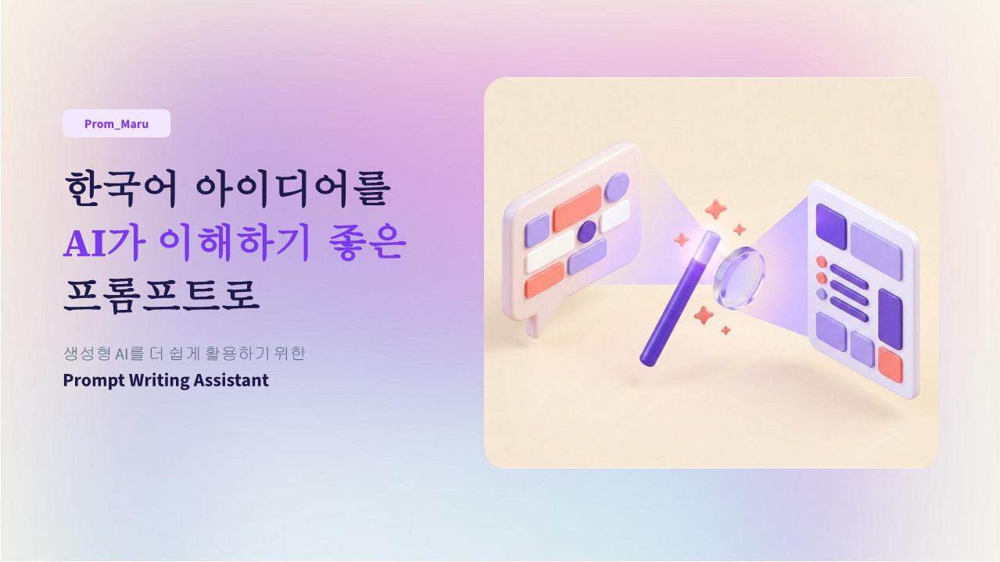
</div>

<br>

---

## 📌 핵심 요약 인포그래픽 (Quick Overview)

| 🎯 8대 카테고리 | 🧭 C-R-A-F-T 구조화 | 🤖 모델별 맞춤 최적화 | 🔒 100% 프라이빗 (BYOK) |
| :---: | :---: | :---: | :---: |
| 문서 · 이미지 · 영상 · 발표<br>오디오 · 코드 · 데이터 · 기타 | Context · Role · Audience<br>Format · Task 자동 분석 | ChatGPT · Midjourney<br>Veo · Sora · Copilot 등 | 서버 DB/로그 0건<br>브라우저 로컬 스토리지 보관 |

---

## 🌟 What is Prom_Maru?

**Prom_Maru(프롬마루)**는 일상적인 한국어로 작성된 아이디어를 글로벌 생성형 AI 모델이 가장 잘 이해할 수 있는 **구조화된 고품질 영문 프롬프트(English Prompt)**로 탈바꿈해주는 **프롬프트 저작 어시스턴트(Prompt Writing Assistant)**입니다.

> ⚠️ **핵심 정의**: Prom_Maru는 이미지나 영상을 직접 렌더링하는 최종 생성 서비스가 아닙니다. **ChatGPT, Claude, Midjourney, Veo, Sora 등 다양한 생성형 AI를 사용할 때 최상의 결과물을 단번에 얻을 수 있도록 프롬프트를 전문적으로 설계해주는 도구**입니다.

* 🌐 **배포 서비스**: [https://prom-maru.onrender.com/](https://prom-maru.onrender.com/)
* 💻 **GitHub 저장소**: [https://github.com/sh11025/Prom_Maru](https://github.com/sh11025/Prom_Maru)

---

## ❓ Why Prom_Maru?

<div align="center">
  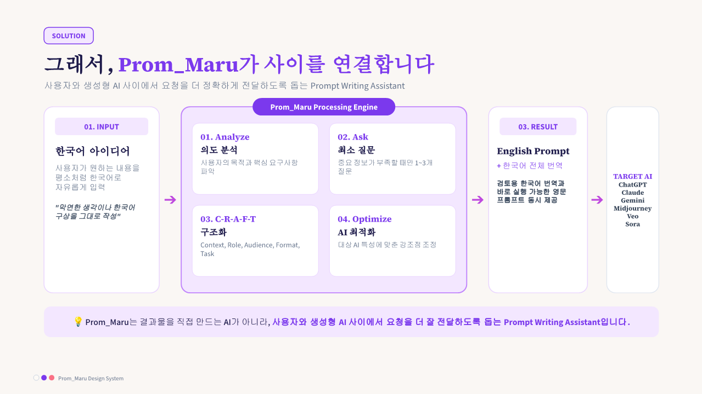
</div>

### "최고 성능의 AI를 써도 원하는 결과가 나오지 않는 이유"
ChatGPT, Midjourney, Veo, Sora 등 최신 AI 모델들은 **구체적인 맥락(Context)과 과업(Task)이 정교한 영문 지시문으로 정의되었을 때** 가장 높은 성능을 냅니다. 하지만 한국어 사용자가 매번 영어로 복잡한 프롬프트 구조와 세부 파라미터를 작성하는 일은 큰 장벽입니다.

### 📊 Before vs After 비교 인포그래픽

| 비교 항목 | ❌ 기존의 프롬프트 작성 (Before) | ✨ Prom_Maru 솔루션 (After) |
| :--- | :--- | :--- |
| **언어 장벽** | 한국어 번역기를 돌려 어색한 영문 직역 생성 | 한국어 의도를 분석하여 자연스럽고 전문적인 **AI 최적화 영문 프롬프트** 도출 |
| **작성 피로도** | 페르소나, 형식, 제약조건 등을 일일이 수동 기재 | **C-R-A-F-T 프레임워크** 기반 핵심 입력 외 역할/청중/형식 자동 추론 |
| **모델 특성 반영** | 모든 AI에 동일한 단순 텍스트 입력 | 대상 AI(이미지/영상/텍스트/코드)별 **특화 문법 및 묘사 방식 자동 최적화** |
| **검토 편의성** | 생성된 영문 프롬프트의 품질 판단이 어려움 | **한국어 1:1 완역본**을 병렬 제공하여 원클릭 검토 및 수정 지원 |
| **보안 및 비용** | 유료 구독 또는 플랫폼 종속 발생 | **BYOK(본인 Gemini API Key)** 사용으로 완전 무료 & 개인정보 수집 없음 |

---

## 🔄 How It Works

<div align="center">
  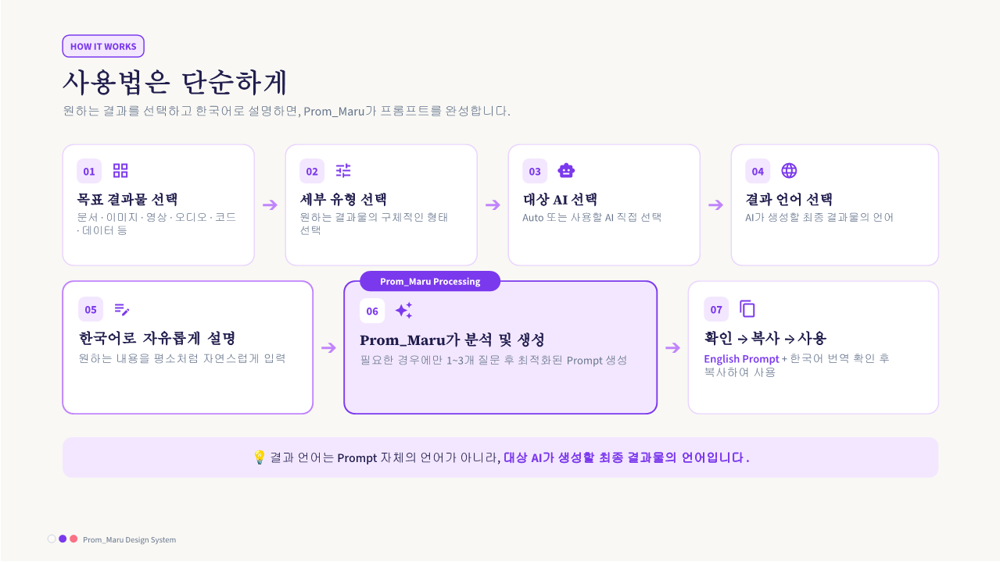
</div>

Prom_Maru는 사용자 편의성과 AI 프롬프트 품질을 극대화하는 **7단계 유기적 파이프라인**으로 작동합니다.

### 📐 파이프라인 흐름도 (End-to-End Pipeline)

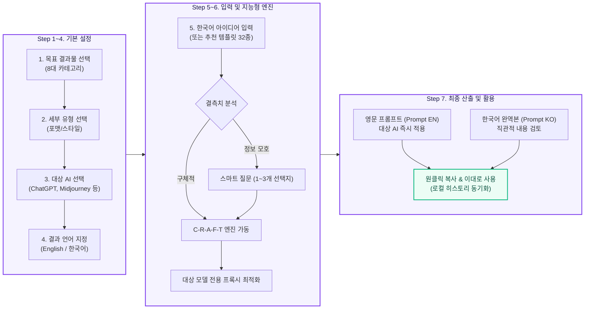

---

### 🎨 8대 카테고리 지원 매트릭스

| 카테고리 | 아이콘 | 대표 세부 유형 | 최적화 대상 AI 모델 예시 |
| :--- | :---: | :--- | :--- |
| **문서 / 텍스트** | 📄 | 블로그 포스트, 사업계획서, 마케팅 카피, 기획서, 보고서, 뉴스레터 | ChatGPT, Claude, Google Gemini |
| **이미지 / 디자인**| 🎨 | 실사 제품 사진, 미니멀 로고, 디지털 일러스트, 3D 캐릭터, UI 목업 | Midjourney, DALL-E 3, Stable Diffusion |
| **프레젠테이션** | 📊 | 스타트업 피치덱 (10-12장), 사업제안 슬라이드, 강의/워크숍 자료 | Gamma, Beautiful.ai, ChatGPT Plus |
| **비디오 / 영상** | 🎬 | 쇼츠/릴스 (15~30초), 시네마틱 트레일러, 제품 광고, 3D 모션 영상 | Google Veo, OpenAI Sora, Runway, Kling |
| **오디오 / 음성** | 🎵 | 내레이션 보이스오버, 팟캐스트 인트로, 시네마틱 BGM, 로파이 비트 | ElevenLabs, Suno, Udio |
| **코드 / 개발** | 💻 | React 컴포넌트, Node.js REST API, SQL 성능 최적화, 파이썬 스크립트 | GitHub Copilot, Cursor, Claude Sonnet |
| **데이터 / 분석** | 📈 | A/B 테스트 가설 검증, KPI 대시보드 지표 설계, 코호트 리텐션 진단 | ChatGPT Advanced Data Analysis, Claude |
| **기타 / 커스텀** | ✨ | 심층 인터뷰 질문지, 브랜드 네이밍/슬로건, 업무 자동화 워크플로 | 전천후 범용 AI 모델 (Auto 모드) |

---

## 🧭 C-R-A-F-T Framework

<div align="center">
  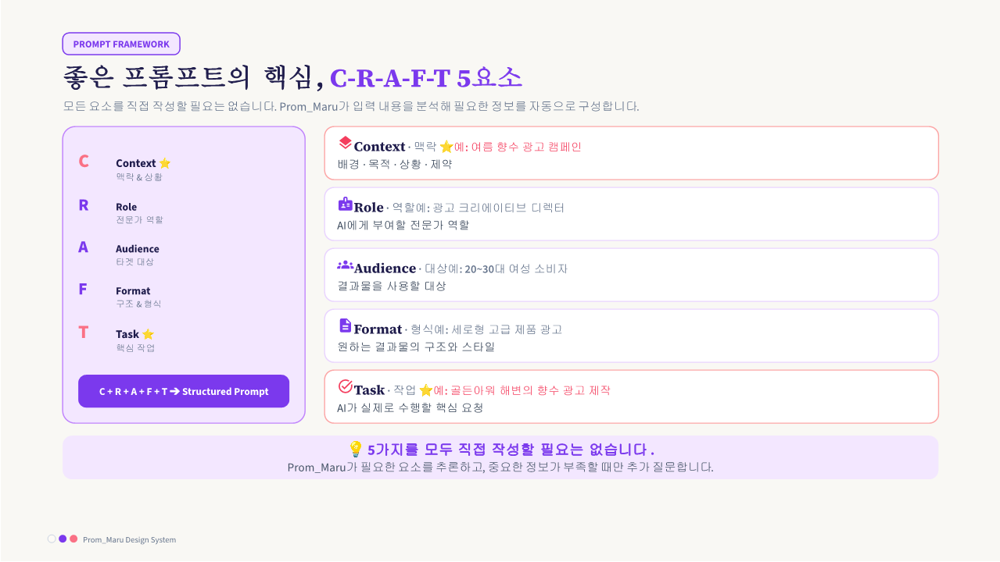
</div>

Prom_Maru는 세계적으로 검증된 프롬프트 엔지니어링 표준인 **C-R-A-F-T 5대 요소**를 기반으로 프롬프트를 빈틈없이 조립합니다.

### 📐 C-R-A-F-T 데이터 결합 다이어그램

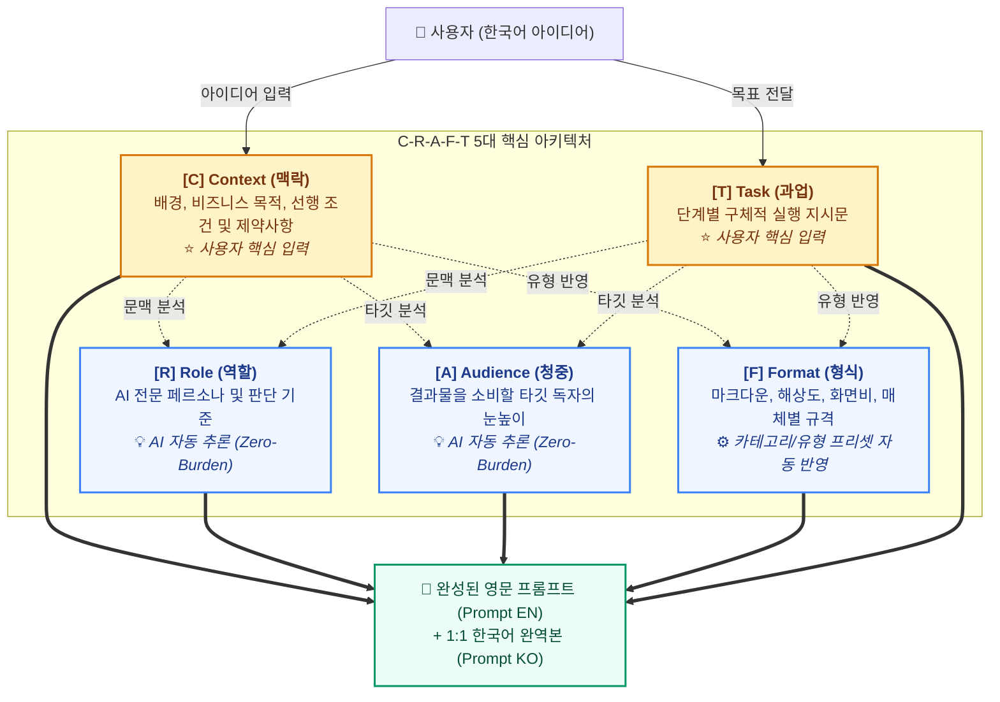

### 📋 C-R-A-F-T 요소 상세 정의

| 요소 | 풀네임 | 설명 | 사용자 입력 원칙 |
| :---: | :--- | :--- | :--- |
| **C** | **Context** (맥락) | 배경, 상황, 프로젝트 목적, 필수 제약사항 | ⭐ **핵심 입력** (사용자가 직접 편하게 설명) |
| **R** | **Role** (역할) | 대상 AI에게 부여할 전문 페르소나 및 태도 | 💡 **자동 추론** (맥락을 분석하여 Prom_Maru가 최적화) |
| **A** | **Audience** (청중) | 결과물을 소비할 고객, 청중, 사용자의 관점 | 💡 **자동 추론** (문맥 기반으로 타깃 눈높이 도출) |
| **F** | **Format** (형식) | 산출물 양식, 계층형 마크다운, 해상도/화면비 | ⚙️ **프리셋 자동 반영** (선택한 카테고리/유형에 맞춰 결정) |
| **T** | **Task** (과업) | AI가 단계별로 수행해야 할 핵심 작업 명령 | ⭐ **핵심 입력** (사용자가 만들고자 하는 핵심 내용) |

> 📌 **Zero-Burden 원칙**: 사용자는 5가지 항목을 억지로 채울 필요가 없습니다. 핵심 아이디어(Context, Task)만 한국어로 편안하게 적으면, Role과 Audience, Format은 Prom_Maru가 최적의 상태로 자동 도출합니다.

---

## 🎯 Target AI Optimization

<div align="center">
  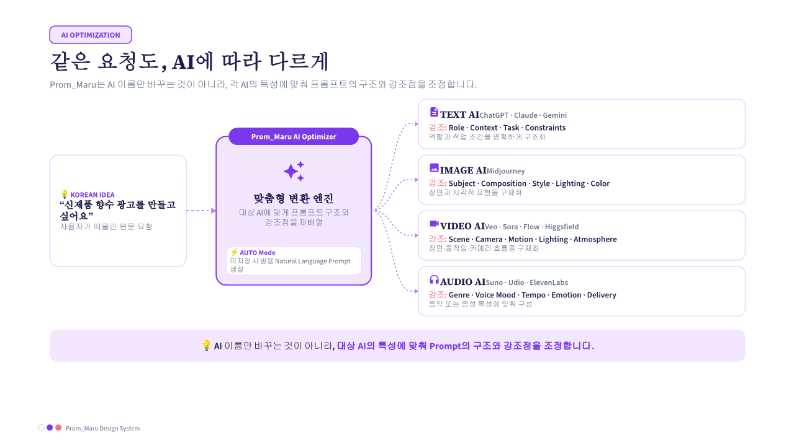
</div>

Prom_Maru는 검증되지 않은 독점 파라미터나 비공개 명령어를 임의로 날조하지 않습니다. **각 AI 모델이 가장 잘 반응하는 자연어 묘사 방식, 정보 구조화 순서, 매체별 강조점**을 정밀하게 분기 최적화합니다.

### 📐 대상 모델별 분기 최적화 맵

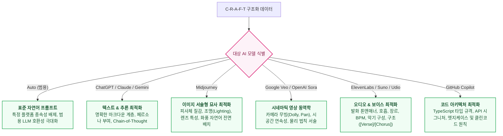

### 🌐 '결과 언어' 설정의 의미
* **프롬프트 본문**: 대상 AI 모델의 인지 능력과 성능 극대화를 위해 항상 **English**로 정교하게 작성됩니다.
* **한국어 완역본**: 사용자의 쉬운 검토와 세부 조정을 위해 **Korean** 번역본이 1:1로 함께 제공됩니다.
* **결과 언어 (Result Language)**: 최종 프롬프트 내에 `Language Directive`를 삽입하여, 대상 AI가 최종 결과물을 산출할 때 적용할 언어(예: 한국어/English)를 명확히 강제합니다.

---

## 📱 Product UI & Experience

<div align="center">
  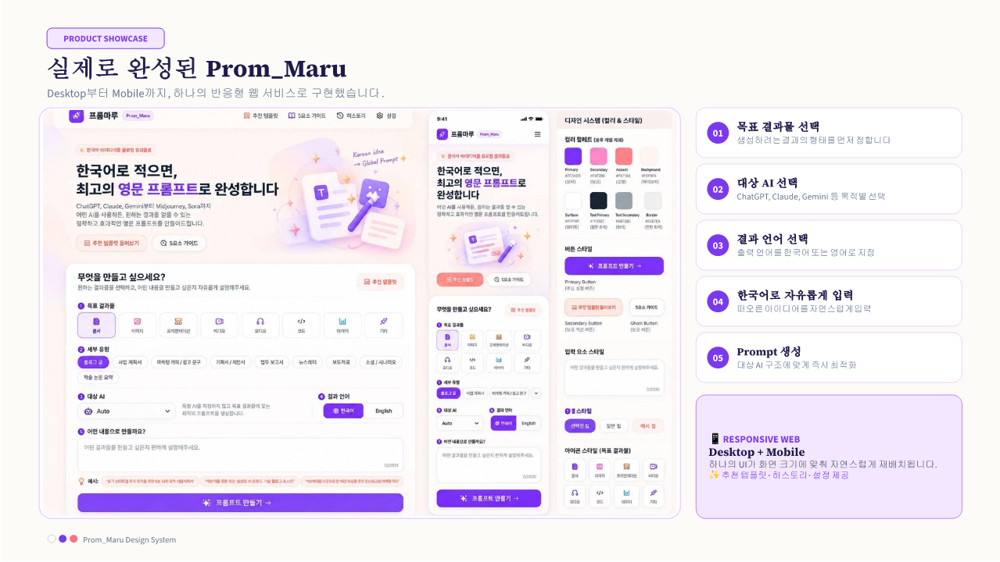
</div>

* **Warm Ivory & Violet/Coral 디자인 시스템**: 장시간 집중 작업 시에도 눈이 편안한 웜 아이보리(`#FAF8F5`) 배경에 프라이머리 바이올렛(`#7C3AED`)과 코랄(`#FB7185`) 엑센트 적용.
* **카드형 워크벤치 (Card Workbench)**: 복잡한 탭 이동 없이 한눈에 프롬프트 편집, C-R-A-F-T 5요소 해체 분석, 완성도 리뷰를 직관적으로 파악.
* **반응형 2-Column 레이아웃**: 데스크톱 환경에서는 좌측 설정/입력과 우측 결과 카드가 나란히 배치되며, 모바일에서는 유연한 싱글 컬럼과 아코디언 드롭다운으로 최적화.

---

## 🏗️ System Architecture

<div align="center">
  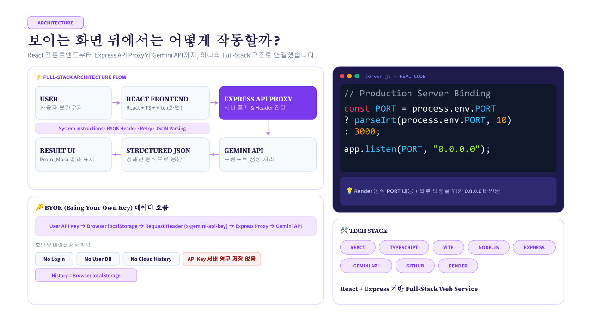
</div>

Prom_Maru는 프론트엔드와 백엔드가 결합된 **Full-Stack SPA + Express API Proxy** 구조로 설계되었습니다.

### 📐 시스템 구조도 (System Architecture Graph)

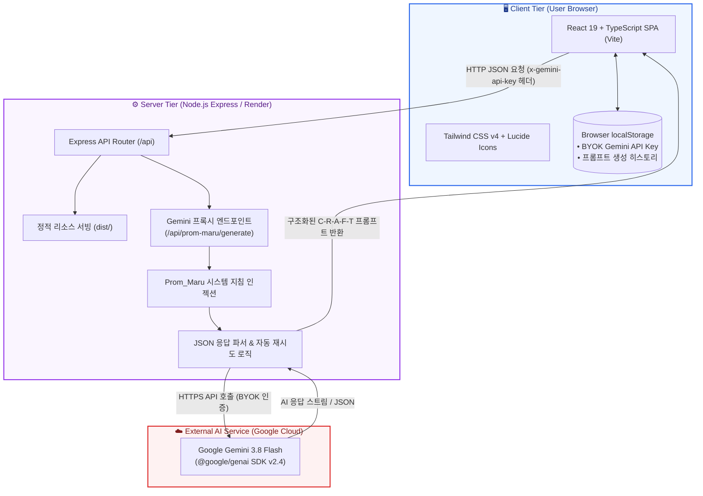

---

## 🔒 BYOK & Privacy Architecture

Prom_Maru는 사용자의 프라이버시를 절대 침해하지 않는 투명한 **무저장(Zero-Retention)** 아키텍처를 고수합니다.

### 📐 데이터 무저장 시퀀스 흐름 (Zero-Retention Flow)

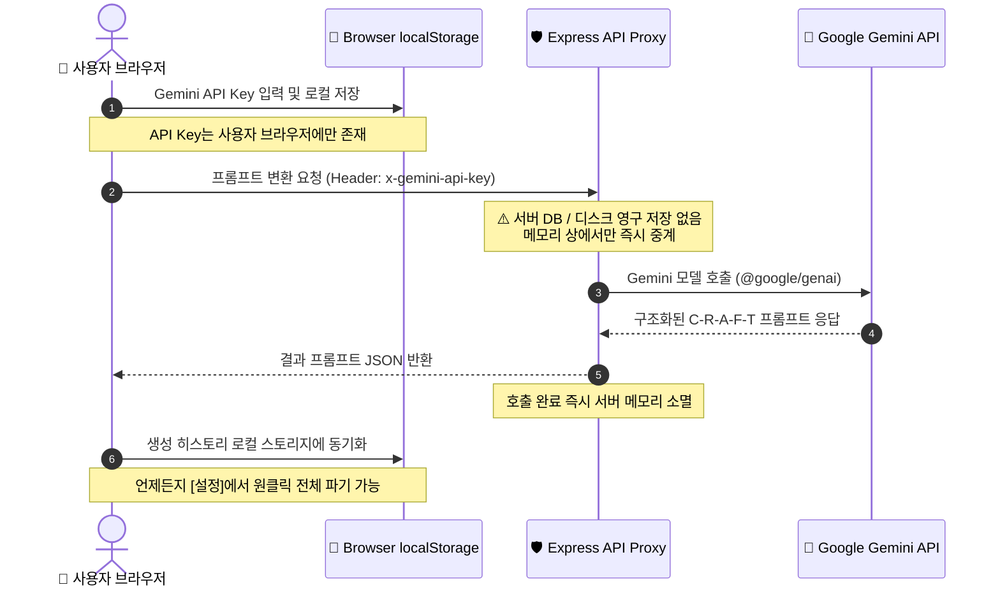

* **BYOK (Bring Your Own Key)**: 각 사용자가 자신의 Google Gemini API Key를 직접 입력하여 독립적으로 사용합니다.
* **회원가입 / 로그인 없음**: 어떠한 개인정보나 계정도 요구하지 않습니다.
* **서버 데이터베이스(DB) 부재**: 서버에 DB가 일체 존재하지 않으며 사용자 데이터나 프롬프트를 보관하지 않습니다.
* **로컬 히스토리 보관**: 프롬프트 생성 기록은 오직 본인 브라우저의 `localStorage`에만 저장됩니다.
* **서버 로그 영구 저장 배제**: API Key는 호출 순간에만 헤더를 통해 프록시로 전달되며, 서버 디스크나 로그에 절대 남기지 않습니다.
* **원클릭 즉시 파기**: 상단 [설정] 메뉴에서 언제든지 API Key와 히스토리 전체를 클릭 한 번으로 파기할 수 있습니다.

---

## 🛠️ Troubleshooting & Build Journey

<div align="center">
  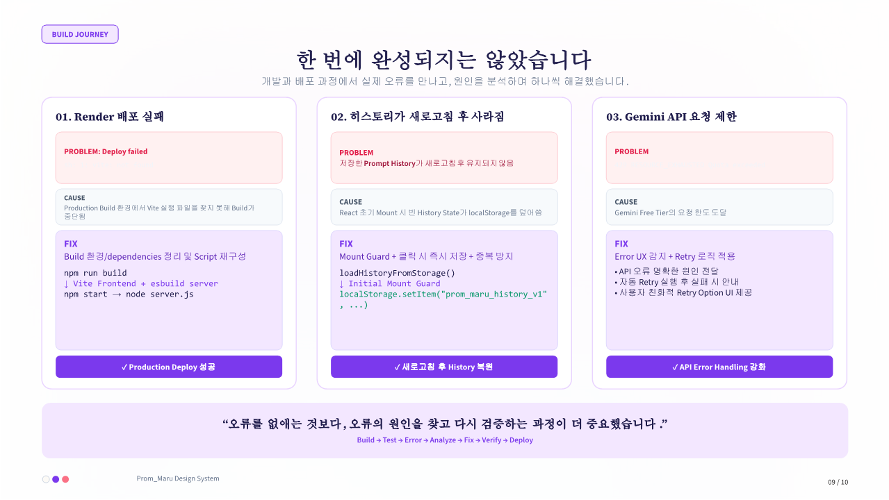
</div>

실제 개발 및 Render 프로덕션 배포 과정에서 직면했던 기술 난제와 그에 대한 아키텍처적 해결 내역입니다.

### 📐 빌드 및 배포 파이프라인

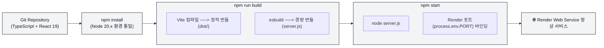

### 📋 주요 트러블슈팅 매트릭스

| 발생 문제 (Problem) | 원인 진단 (Root Cause) | 최종 해결책 (Solution) |
| :--- | :--- | :--- |
| **정적 호스팅 배포 불가** | Gemini 프록시와 프롬프트 시스템 지침을 집행할 Node.js 런타임 부재 | 정적 호스팅 대신 프론트+백엔드 일체형 **Render Web Service** 구조로 전환 확정 |
| **Render Node 빌드 실패 (Exit 127)** | `engines.node`가 `>=20.0.0`으로 넓게 열려 빌드기가 미지원 Node 26을 자동 선택 | `engines.node`를 LTS 버전인 `"20.x"`로 명확히 제한하여 일관된 빌드 환경 확보 |
| **`server.ts` 프로덕션 실행 오버헤드** | `tsx`를 프로덕션에서 직접 구동 시 런타임 안정성 및 메모리 오버헤드 발생 | `esbuild`로 `server.ts`를 경량 `server.js`로 사전 번들링 후 `node server.js`로 가볍게 구동 |
| **새로고침 시 히스토리 유실** | 컴포넌트 마운트 시 `useEffect([history])`가 초기 빈 배열로 스토리지 덮어씀 | `loadHistoryFromStorage` 동기 초기화 + `isInitialMount` 가드 적용 및 `[이대로 사용]` 즉시 동기 저장 |
| **동일 프롬프트 중복 저장** | 다회 클릭 시 동일한 영문 프롬프트가 히스토리에 중복 적재 | `promptEn.trim()` 기반 고유 식별자 검사 로직을 추가하여 중복 저장 차단 |
| **Gemini 429 Quota 에러 노출** | 무료 티어 API 한도 초과 시 원시 에러가 사용자에게 그대로 노출 | 서버 에러 핸들러에서 429를 포착하여 친절한 한국어 안내 메시지로 치환 및 모델 폴백 적용 |

---

## 💻 Tech Stack

| 계층 | 기술 스택 | 설명 |
| :--- | :--- | :--- |
| **Frontend** | React 19, TypeScript 5.x, Vite 6.x | 최신 리액트 SPA, 타입 안정성 및 초고속 빌드 |
| **Styling** | Tailwind CSS v4, Lucide Icons | 모던 유틸리티 스타일링 및 가벼운 벡터 아이콘 시스템 |
| **Backend** | Node.js 20.x, Express 4.21, esbuild 0.28 | API 프록시 서버, 정적 파일 서빙, 경량 번들링 |
| **AI Engine** | Google Gemini API (`@google/genai` v2.4) | `gemini-3.8-flash` 기반 고속 C-R-A-F-T 프롬프트 생성 |
| **Storage** | Browser `localStorage` | 서버 DB 없는 100% 프라이빗 클라이언트 스토리지 |
| **Deployment** | Render Web Service | 프론트엔드 + 백엔드 통합 클라우드 컨테이너 서빙 |

---

## 🚀 Getting Started

### 1. 사전 요구사항
* **Node.js**: `20.x` (권장)
* **npm**: `10.x` 이상
* **Google Gemini API Key**: [Google AI Studio](https://aistudio.google.com/)에서 무료 발급

### 2. 설치 및 로컬 실행
```bash
# 1. 저장소 복제
git clone https://github.com/sh11025/Prom_Maru.git
cd Prom_Maru

# 2. 패키지 의존성 설치
npm install

# 3. 개발 서버 시작 (http://localhost:3000)
npm run dev
```

### 3. 프로덕션 빌드 & 실행
```bash
# Vite 정적 번들(dist/) + server.ts 컴파일(server.js)
npm run build

# Node.js 프로덕션 서버 시작
npm start
```

---

## ☁️ Deployment

Prom_Maru는 Express 서버가 백엔드 API 프록시와 프론트엔드 정적 서빙을 동시에 전담하므로 **Render Web Service**에 배포되어 있습니다.

* **Build Command**: `npm install && npm run build`
* **Start Command**: `npm start`
* **Port Handling**: `process.env.PORT || 3000` (Render 주입 포트 자동 바인딩)

---

## 📊 Project Presentation

Prom_Maru의 프로젝트 기획, 핵심 가치, 아키텍처 및 구현 성과를 정리한 **최종 10페이지 발표자료**입니다.  
슬라이드 원본 이미지는 저장소의 `docs/` 디렉터리에 보관되어 있습니다.

<div align="center">
  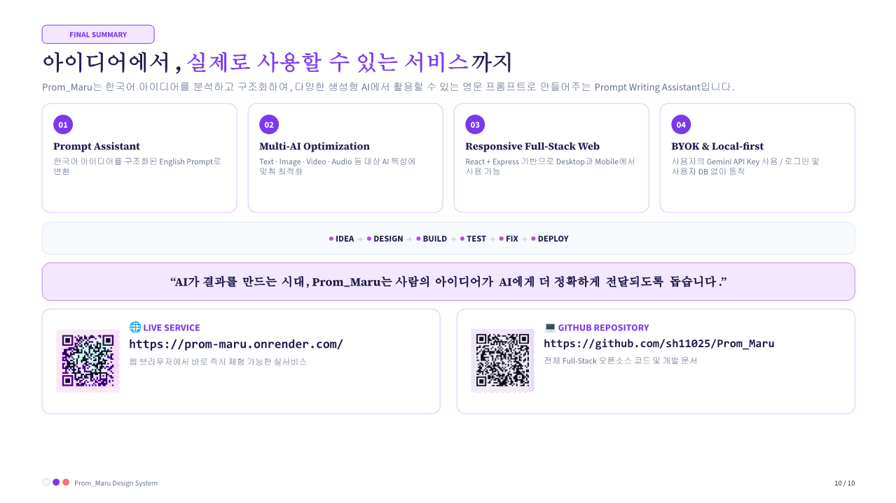
  <p><em>▲ Prom_Maru 최종 프로젝트 요약 (Slide 10)</em></p>
</div>

<br>

<details>
<summary><strong>👉 최종 10페이지 발표자료 전체 펼쳐보기 (Slide 01 ~ 10)</strong></summary>
<br>

<div align="center">

<p><strong>01. Cover: 한국어 아이디어를 AI가 이해하기 좋은 프롬프트로</strong></p>

<hr>

<p><strong>02. Problem: 좋은 AI를 써도 원하는 결과가 나오지 않는 이유</strong></p>
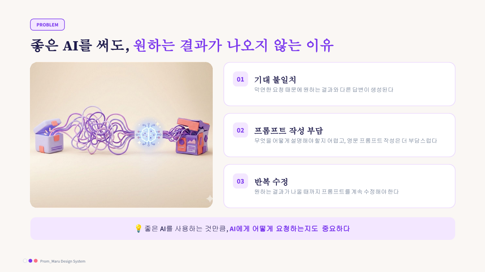
<hr>

<p><strong>03. Solution: Prom_Maru가 사용자와 생성형 AI 사이를 연결</strong></p>

<hr>

<p><strong>04. How It Works: 목표 결과물부터 최종 프롬프트 복사까지의 7단계 흐름</strong></p>

<hr>

<p><strong>05. C-R-A-F-T Framework: Context, Role, Audience, Format, Task</strong></p>

<hr>

<p><strong>06. AI Optimization: 대상 AI에 따른 프롬프트 구조와 강조점 분기 최적화</strong></p>

<hr>

<p><strong>07. Product Showcase: 실제로 구현된 Desktop / Mobile Responsive UI</strong></p>

<hr>

<p><strong>08. Architecture: Full-Stack SPA + Express Proxy + BYOK</strong></p>

<hr>

<p><strong>09. Build Journey: 실제 개발 과정의 문제 진단과 트러블슈팅</strong></p>

<hr>

<p><strong>10. Final Summary: 완성된 Prom_Maru 프로젝트 요약 (Live Service & GitHub)</strong></p>


</div>

</details>

---

## 📄 License

This project is licensed under the Apache License 2.0.  
자세한 내용은 [LICENSE](LICENSE) 파일을 참조하세요.

---

<div align="center">
  <strong>Prom_Maru (프롬마루)</strong> • 한국어 사용자를 위한 AI 프롬프트 아키텍트<br>
  Context • Role • Audience • Format • Task<br>
  <a href="https://prom-maru.onrender.com/">https://prom-maru.onrender.com/</a>
</div>
